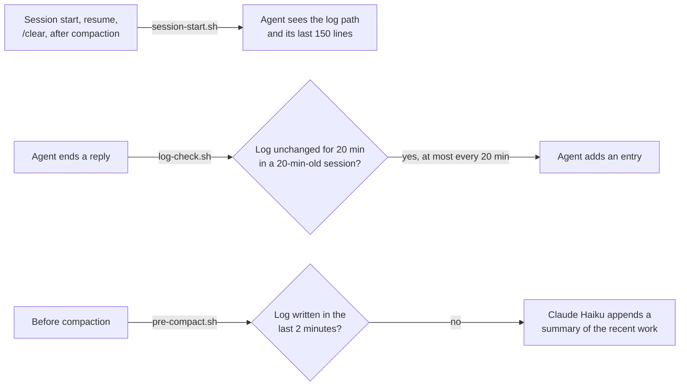

<p align="center">
  
</p>

<h1 align="center">Tandem</h1>

<p align="center">
  <strong>Session continuity for coding agents.</strong><br>
  One append-only log per repo, read back at session start and after compaction.
</p>

<p align="center">
  <a href="LICENSE"></a>
</p>

---

Coding agents forget. A new session starts blank, and compaction throws away the reasoning behind the work in progress. Tandem keeps one log per repo at `.agents/progress.md` and makes sure the agent writes to it and reads it back. It is three small hook scripts with no other moving parts, and it works in Claude Code and Codex.

## How it works



- **`session-start.sh`** prints the log's path and its last 150 lines. Both tools add that to the model's context.
- **`log-check.sh`** runs when the agent finishes a reply. If the log has gone stale, it sends the agent back once to add an entry. It never fires twice in a row, and at most once every 20 minutes.
- **`pre-compact.sh`** runs before compaction. If the agent hasn't written the log in the last two minutes, it has Claude Haiku summarise the end of the conversation into a dated entry. Settings, hooks and tools are switched off for that call.

All three do nothing outside a git repo.

## Requirements

- `bash`, `git` and `jq`
- The `claude` CLI, for the before-compaction summary only

## Install

### Claude Code

```
/plugin marketplace add jonny981/claude-tandem
/plugin install tandem@tandem-marketplace
```

### Codex

Add the three scripts to `~/.codex/hooks.json`, pointing at your clone:

```json
{
  "hooks": {
    "SessionStart": [{ "hooks": [{ "type": "command", "command": "$HOME/claude-tandem/plugins/tandem/scripts/session-start.sh" }] }],
    "Stop":         [{ "hooks": [{ "type": "command", "command": "$HOME/claude-tandem/plugins/tandem/scripts/log-check.sh" }] }],
    "PreCompact":   [{ "hooks": [{ "type": "command", "command": "$HOME/claude-tandem/plugins/tandem/scripts/pre-compact.sh", "timeout": 30 }] }]
  }
}
```

Codex asks you to approve new hooks once, with `/hooks`.

### Keep the log out of git

Add this line to your global git ignore file (`git config --global core.excludesFile` shows where it is):

```
.agents/progress.md
```

## Writing the log

Tell your agent what belongs in it, for example in `AGENTS.md`:

```markdown
Keep an append-only session log at `.agents/progress.md`. Add an entry when you
make a decision and why, change approach, hit a constraint, get corrected, or
finish a piece of work. Skip trivial continuations.
```

## Tests

```bash
git submodule update --init --recursive
make test    # bats tests
make lint    # shellcheck
```

## License

[MIT](LICENSE)
